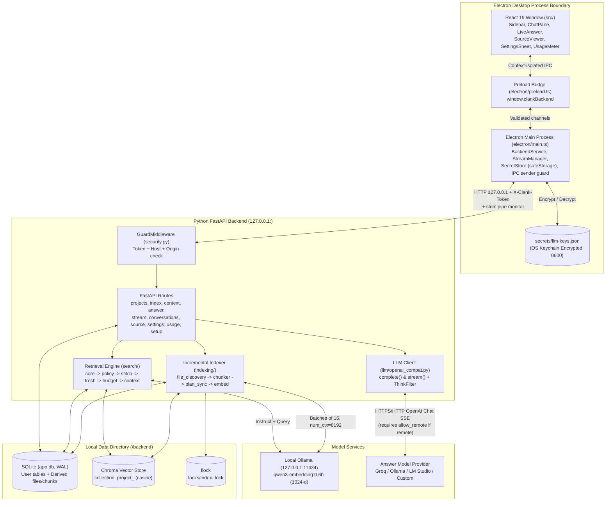
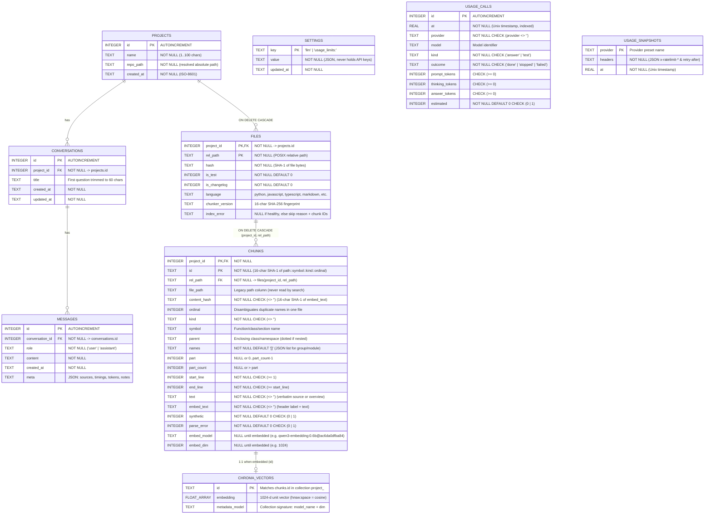

# Clank

Local code search and Q&A desktop application for software repositories.

Clank indexes a codebase on your machine and answers natural-language questions about it with cited source locations (`path:start-end`). File discovery, syntax-aware chunking, embedding (through [Ollama](https://ollama.com)), vector storage (Chroma), metadata storage (SQLite) and retrieval all run locally. An answer model of your choice (hosted or local, via any OpenAI-compatible chat endpoint) then writes the answer live from the retrieved code excerpts.

**Status:** in development. The syntax-aware chunker, local embedding client, crash-safe incremental indexer, retrieval and sibling-stitching pipeline, retrieval evaluation harness, local FastAPI server, streaming answer engine, multi-turn saved conversations, strict source viewer, usage and rate-limit tracker, Electron security boundary, Apple-style desktop interface and frozen PyInstaller packaging are complete and tested (`2,464` Python tests, `355` Electron tests and `332` UI logic tests).

---

## Table of contents

1. [Overview](#1-overview)
2. [System architecture and box diagrams](#2-system-architecture-and-box-diagrams)
   - [High-level system architecture](#21-high-level-system-architecture)
   - [Incremental indexing pipeline](#22-incremental-indexing-pipeline)
   - [Search, stitching and live answer streaming pipeline](#23-search-stitching-and-live-answer-streaming-pipeline)
3. [Database schema and entity-relationship diagram (ERD)](#3-database-schema-and-entity-relationship-diagram-erd)
   - [Relational and vector store ERD](#31-relational-and-vector-store-erd)
   - [Table definitions and invariants](#32-table-definitions-and-invariants)
4. [Subsystem deep dive](#4-subsystem-deep-dive)
   - [Safe file discovery](#41-safe-file-discovery)
   - [Syntax-aware chunking](#42-syntax-aware-chunking)
   - [Local embedding client](#43-local-embedding-client)
   - [Crash-safe incremental indexing](#44-crash-safe-incremental-indexing)
   - [Search, ranking, sibling stitching and context assembly](#45-search-ranking-sibling-stitching-and-context-assembly)
   - [Answer generation, live streaming and multi-turn memory](#46-answer-generation-live-streaming-and-multi-turn-memory)
   - [Usage tracking and rate-limit estimation](#47-usage-tracking-and-rate-limit-estimation)
   - [Security boundary and Electron supervisor](#48-security-boundary-and-electron-supervisor)
5. [Key architectural decisions](#5-key-architectural-decisions)
6. [Engineering challenges and how they were solved](#6-engineering-challenges-and-how-they-were-solved)
7. [Retrieval evaluation and benchmarks](#7-retrieval-evaluation-and-benchmarks)
8. [How to run locally (every detail)](#8-how-to-run-locally-every-detail)
   - [Prerequisites](#81-prerequisites)
   - [Install dependencies and pull the embedding model](#82-install-dependencies-and-pull-the-embedding-model)
   - [Run the desktop app in development](#83-run-the-desktop-app-in-development)
   - [Configure an answer model](#84-configure-an-answer-model)
   - [Run the Python backend standalone (without Electron)](#85-run-the-python-backend-standalone-without-electron)
   - [Build the packaged desktop installer](#86-build-the-packaged-desktop-installer)
   - [Run the retrieval evaluation harness](#87-run-the-retrieval-evaluation-harness)
9. [Testing and verification suite](#9-testing-and-verification-suite)
10. [Local API reference](#10-local-api-reference)
11. [Project layout](#11-project-layout)
12. [Data locations](#12-data-locations)
13. [Known limitations and roadmap](#13-known-limitations-and-roadmap)

---

## 1. Overview

Most code repositories are too large to fit inside a language model's context window, and naive fixed-size text splitting cuts functions and classes in half. Clank solves this with a local retrieval pipeline designed specifically for source code:

1. **Discover (`backend/file_discovery.py`).** Walks the project folder, pruning ignored directories (`node_modules`, `.git`, `.venv`, `dist`, `build`) and respecting `.gitignore`. Skips lockfiles, minified bundles, binary files, files over `1 MB` (`20 KB` for `.json`/`.yaml`), special files (FIFOs, sockets, devices) and symlinks that resolve outside the repository.
2. **Chunk (`backend/chunker/`, `backend/languages.py`).** Parses Python (`.py`), JavaScript (`.js`, `.jsx`) and TypeScript (`.ts`, `.tsx`) into syntax trees with tree-sitter, and splits Markdown (`.md`), reStructuredText (`.rst`) and small config files (`.json`, `.yaml`, `.yml`). Each chunk is a complete function, method, class overview, import block, module-level run, interface, type alias, enum or document section. Tiny neighbouring chunks in the same scope are grouped (`< 125` tokens), and oversized chunks (`> 800` tokens) are split along statement boundaries first, then line windows, then characters.
3. **Embed (`backend/embedding/ollama.py`).** Sends each chunk's labelled text (`<rel_path> · <Parent.symbol>\n<code_text>`) to a local Ollama server running `qwen3-embedding:0.6b` (`1024` dimensions, `8192` context window, `truncate: false`).
4. **Store (`backend/db.py`, `backend/chunk_store.py`, `backend/vectorstore/`).** Saves vectors to a per-project Chroma HNSW cosine collection and commits chunk rows and file hashes to SQLite (WAL mode) in a strict crash-safe order.
5. **Search and stitch (`backend/search/`).** Embeds the question with an instruction prefix, retrieves candidate vectors, demotes test files (`-0.15`) and changelogs (`-0.30`) unless the question asks for them, stitches split sibling parts back into complete code passages, verifies live file hashes for staleness or deletion, narrows giant passages and packs a strict ranking prefix into the token budget.
6. **Answer (`backend/llm/`, `backend/answer.py`, `backend/routes_answer.py`).** Sends the assembled code context, recent conversation turns and the question to an OpenAI-compatible chat model. Streams stage transitions (`searching`, `waiting`, `thinking`, `writing`), token counts and markdown answer deltas to the window, and closes the upstream model socket immediately if the user presses Stop.

---

## 2. System architecture and box diagrams

### 2.1 High-level system architecture

```
+---------------------------------------------------------------------------------------------------+
|                                      ELECTRON DESKTOP APP                                         |
|                                                                                                   |
|  +----------------------------------------+           +----------------------------------------+  |
|  |       Renderer Window (React 19)       |           |      Electron Main Process (Node)      |  |
|  |  - Sidebar, ChatPane, MessageList      |           |  - BackendService (spawns/monitors py) |  |
|  |  - LiveAnswer, PartialAnswer, Markdown |  Preload  |  - Per-launch 32-byte random token     |  |
|  |  - SourceViewer (reference + browse)   | <=======> |  - Trusted sender URL check on IPC     |  |
|  |  - UsageMeter & SettingsSheet (2 tabs) |    IPC    |  - StreamManager (NDJSON -> 25Hz IPC)  |  |
|  |  - Never sees API token, port or keys  |           |  - SecretStore (Electron safeStorage)  |  |
|  +----------------------------------------+           +-------------------+--------------------+  |
|                                                                           |                       |
+---------------------------------------------------------------------------|-----------------------+
                                                                            |
                                          HTTP over 127.0.0.1:<random_port> | + X-Clank-Token header
                                          + stdin pipe lifecycle monitor    |
                                                                            v
+---------------------------------------------------------------------------------------------------+
|                                   PYTHON BACKEND (FastAPI / Uvicorn)                              |
|                                                                                                   |
|  +---------------------------------------------------------------------------------------------+  |
|  | GuardMiddleware (security.py): requires X-Clank-Token, Host in {127.0.0.1, localhost},      |  |
|  | Origin in allowlist. Refuses to boot without CLANK_API_TOKEN (32+ chars).                   |  |
|  +---------------------------------------------------------------------------------------------+  |
|         |                        |                        |                        |              |
|         v                        v                        v                        v              |
|  +--------------+        +---------------+        +---------------+        +---------------+      |
|  | Indexing     |        | Search &      |        | Answer &      |        | Source View,  |      |
|  | Pipeline     |        | Context       |        | Conversations |        | Setup & Usage |      |
|  | - discovery  |        | - search/core |        | - routes_ans  |        | - source_view |      |
|  | - chunker    |        | - policy      |        | - llm/stream  |        | - model_pull  |      |
|  | - plan_sync  |        | - stitch      |        | - think_filter|        | - usage_report|      |
|  | - jobs.py    |        | - fresh/budget|        | - history     |        | - usage_limits|      |
|  +------+-------+        +-------+-------+        +-------+-------+        +-------+-------+      |
|         |                        |                        |                        |              |
+---------|------------------------|------------------------|------------------------|--------------+
          |                        |                        |                        |
          v                        v                        v                        v
+------------------------------------------+    +-----------------------+    +----------------------+
|      LOCAL STORAGE (<userData>/backend)  |    |     LOCAL OLLAMA      |    |    ANSWER MODEL      |
|                                          |    |  127.0.0.1:11434      |    | (Remote or Local)    |
|  +------------------------------------+  |    |  - qwen3-embedding    |    | - Groq (gpt-oss-120b)|
|  | SQLite (app.db, WAL, FK=ON)        |  |    |    :0.6b (1024-d)     |    | - Ollama /v1         |
|  | - User: projects, conversations,   |  |    |  - /api/embed         |    | - LM Studio /v1      |
|  |   messages, settings, usage_*      |  |    |  - /api/tags (digest) |    | - Custom OpenAI URL  |
|  | - Derived (v3): files, chunks      |  |    |  - /api/pull          |    | (Requires consent    |
|  +------------------------------------+  |    +-----------------------+    |  switch if remote)   |
|  | Chroma (chroma/project_<id>)       |  |                                 +----------------------+
|  | - HNSW cosine vectors + signature  |  |
|  +------------------------------------+  |
|  | File Locks (locks/index-<id>.lock) |  |
|  +------------------------------------+  |
+------------------------------------------+
```



---

### 2.2 Incremental indexing pipeline

Every indexing run (`index_project` in `backend/indexing/index.py`) executes in a strict, idempotent order so a crash or `kill -9` at any instruction never leaves a row in SQLite claiming a vector that does not exist in Chroma:

```
+-----------------------------------------------------------------------------------+
| 1. ACQUIRE PROJECT LOCK (`locks/index-<project_id>.lock`, non-blocking flock)     |
|    - Refuses immediately with 409 `index_already_running` if another run is live. |
+-----------------------------------------+-----------------------------------------+
                                          |
                                          v
+-----------------------------------------------------------------------------------+
| 2. WARM UP EMBEDDER (`embedder.warmup()`)                                         |
|    - Calls Ollama `GET /api/tags` to learn `tag@digest12` and warms `/api/embed`. |
|    - If Ollama is down or model is missing, stops BEFORE touching SQLite/Chroma.  |
+-----------------------------------------+-----------------------------------------+
                                          |
                                          v
+-----------------------------------------------------------------------------------+
| 3. MATCH STORE SIGNATURE (`store.signature() == (model_name, dim)`)               |
|    - If model or digest changed, runs 3 repeatable steps:                         |
|      (a) `forget_embeddings` in SQLite -> (b) `store.clear()` -> (c) stamp sig.   |
+-----------------------------------------+-----------------------------------------+
                                          |
                                          v
+-----------------------------------------------------------------------------------+
| 4. HEAL LOST VECTORS (`sqlite_embedded_ids - store.ids()`)                        |
|    - Clears `embed_model`/`embed_dim` on any SQLite row whose vector is missing   |
|      in Chroma so the file-hash shortcut will not skip it.                        |
+-----------------------------------------+-----------------------------------------+
                                          |
                                          v
+-----------------------------------------------------------------------------------+
| 5. DISCOVER & SORT FILES (`discover_files`)                                       |
|    - Healthy / new files sort first; files flagged with `index_error` on the      |
|      previous run sort LAST so permanent bad files cannot block healthy ones.     |
+-----------------------------------------+-----------------------------------------+
                                          |
                                          v
+-----------------------------------------------------------------------------------+
| 6. PER-FILE LOOP                                                                  |
|    +---------------------------------------------------------------------------+  |
|    | 6a. File-hash shortcut check:                                             |  |
|    |     Skip without parsing if ALL 4 hold:                                   |  |
|    |     (1) sha1(file_bytes) == files.hash                                    |  |
|    |     (2) files.chunker_version == current chunker fingerprint              |  |
|    |     (3) 0 chunks in file need embedding for (model_name, dim)             |  |
|    |     (4) files.index_error IS NULL                                         |  |
|    +-------------------------------------+-------------------------------------+  |
|                                          | (otherwise)                            |
|                                          v                                        |
|    +---------------------------------------------------------------------------+  |
|    | 6b. `chunk_file` -> `plan_sync(old_rows, new_chunks, model_name, dim)`    |  |
|    |     Buckets: `new`, `changed`, `needs_vector`, `moved`, `unchanged`,      |  |
|    |     `gone`. (`to_embed = new + changed + needs_vector`)                   |  |
|    +-------------------------------------+-------------------------------------+  |
|                                          |                                        |
|                                          v                                        |
|    +---------------------------------------------------------------------------+  |
|    | 6c. `embed_chunks` (NO SQLite transaction open while calling Ollama)      |  |
|    |     -> `store.upsert` (write vectors to Chroma FIRST)                     |  |
|    |     -> `save_file_chunks` (1 SQLite transaction: upsert file + chunks,    |  |
|    |        record `embed_model`/`embed_dim`, delete removed rows, clear flag) |  |
|    |     -> `store.delete` (remove vanished chunk IDs from Chroma LAST)        |  |
|    +---------------------------------------------------------------------------+  |
+-----------------------------------------+-----------------------------------------+
                                          |
                                          v
+-----------------------------------------------------------------------------------+
| 7. END-OF-RUN CLEANUP (ONLY if run completed without stopping early)              |
|    - Delete SQLite rows + Chroma vectors for files deleted from disk.             |
|    - Sweep orphan vectors (`store.ids() - sqlite_all_ids`) from Chroma.           |
+-----------------------------------------------------------------------------------+
```

---

### 2.3 Search, stitching and live answer streaming pipeline

```
Question + k + allow_remote + conversation_id
  |
  v
+-----------------------------------------------------------------------------------+
| 1. PRE-FLIGHT CHECKS (`routes_answer.py:_prepare`, runs BEFORE HTTP 200 stream)   |
|    - Verify project exists (404) and conversation belongs to project (404).       |
|    - Build LLM client from saved settings + in-memory key (503 if unconfigured).  |
|    - Check remote consent: if host is not local, require `allow_remote=True`(403).|
|    - Verify embedder ready (503) and index signature matches embedder (409).      |
+-----------------------------------------+-----------------------------------------+
                                          |
                                          v
+-----------------------------------------------------------------------------------+
| 2. RETRIEVAL & RANKING (`search/core.py` + `search/policy.py`)                    |
|    - Wrap question: `Instruct: Given a question...\nQuery: <question>`.           |
|    - Query Chroma for candidate pool (`max(3k, 30)`, widening if hidden/orphans). |
|    - Filter out orphan vectors and chunks belonging to flagged files.             |
|    - Apply test/changelog demotion (unless question has test/changelog keywords): |
|      subtract 0.15 from test files and 0.30 from changelogs for sort order only.  |
+-----------------------------------------+-----------------------------------------+
                                          |
                                          v
+-----------------------------------------------------------------------------------+
| 3. SIBLING EXPANSION & STITCHING (`search/stitch.py`)                             |
|    - Merge hits on split parts (`part 0..N-1`) of the same chunk into 1 passage.  |
|    - Reconstruct full text across 4 split shapes: contiguous statements,          |
|      overlapping line windows, repeated-header class overviews, character cuts.   |
|    - If interior parts are missing and live file hash matches, read live lines.   |
+-----------------------------------------+-----------------------------------------+
                                          |
                                          v
+-----------------------------------------------------------------------------------+
| 4. FRESHNESS, CEILING & PREFIX BUDGET (`fresh.py`, `stitch._narrow`, `context.py`)|
|    - Hash live files on disk: drop deleted files BEFORE budgeting; mark edited    |
|      files as `STALE` in passage header and `[Notes]`.                            |
|    - Narrow any passage > `2 * budget - 250` tokens around the hit parts.         |
|    - Select largest strict prefix of ranked passages fitting `max_tokens`         |
|      (never drop #1 passage; mark `over_budget` if #1 alone exceeds budget).      |
+-----------------------------------------+-----------------------------------------+
                                          |
                                          v
+-----------------------------------------------------------------------------------+
| 5. OPEN MODEL STREAM & EMIT NDJSON (`llm/openai_compat.py` -> `StreamManager`)    |
|    - Load recent conversation turns (`<= 1500` tokens, answers capped at 2000 ch).|
|    - Open HTTP/HTTPS connection to provider BEFORE starting FastAPI stream so     |
|      401/404/413/429 return standard HTTP error responses + rate-limit headers.   |
|    - Stream NDJSON lines: `start` -> `stage(thinking)` -> `thinking` ->           |
|      `stage(writing)` -> `delta` -> `done` (or `error`).                          |
|    - Electron `StreamManager` validates lines, coalesces deltas (~25 msgs/sec)    |
|      and pushes to the requesting window.                                         |
|    - On complete: save exchange to SQLite + record usage call + header snapshot.  |
|    - On Stop / window close: abort request -> async generator `finally` closes    |
|      upstream model socket immediately -> record call as `stopped` (not saved).   |
+-----------------------------------------------------------------------------------+
```

---

## 3. Database schema and entity-relationship diagram (ERD)

### 3.1 Relational and vector store ERD

Clank uses SQLite (`app.db` in WAL mode with `PRAGMA foreign_keys = ON` and a `5 s` busy timeout) as the single source of truth for both user data and chunk metadata, paired with Chroma for vectors and an OS-encrypted JSON store for API keys.



### 3.2 Table definitions and invariants

SQLite tables in `backend/db.py` are split into two categories:

1. **User tables (`USER_TABLES_SQL`, never dropped on schema upgrades):**
   - `projects`: registered repository folders. Paths are resolved (`Path.resolve()`) and checked under an immediate write lock (`BEGIN IMMEDIATE`) so the same folder cannot be registered twice under different spellings or symlinks. Root (`/`) and the home folder (`~`) are refused as too broad.
   - `conversations` and `messages`: saved per-project chats. `messages.meta` stores the JSON metadata of an assistant reply (`sources`, `timings`, `thinking`, `tokens`, `dropped`, `hidden_files`, `stale_files`, `deleted_files`, `notice`, `sent_off_machine`). When an older database without `meta` opens, `init_db()` migrates it in place with `ALTER TABLE messages ADD COLUMN meta TEXT`.
   - `settings`: key-value JSON settings (`llm` for the active provider selection; `usage_limits:<provider>` for user-configured rate limits). No API key is ever written here.
   - `usage_calls`: one row per model call that spent tokens. By design (enforced by a schema test in `test_usage_store.py`), it has **no** column for questions, answers, project IDs or file paths.
   - `usage_snapshots`: stores the latest `x-ratelimit-*` and `retry-after` HTTP headers per provider (values truncated to `64` characters).

2. **Derived index tables (`CHUNK_TABLES_SQL`, governed by `PRAGMA user_version = SCHEMA_VERSION`, currently `3`):**
   - When `SCHEMA_VERSION` changes, `init_db()` drops and recreates `files` and `chunks` while leaving all user tables untouched, and returns `True` so the caller wipes the vector store to match.
   - `chunks` enforces data integrity at the database level via SQL `CHECK` constraints (`test_constraints.py`):
     - `start_line >= 1` and `end_line >= start_line`
     - `text <> ''`, `embed_text <> ''`, `kind <> ''`, `content_hash <> ''`
     - `synthetic IN (0, 1)` and `parse_error IN (0, 1)`
     - `(part IS NULL AND part_count IS NULL) OR (part IS NOT NULL AND part_count IS NOT NULL AND part >= 0 AND part < part_count)`
     - `(embed_model IS NULL AND embed_dim IS NULL) OR (embed_model IS NOT NULL AND embed_model <> '' AND embed_dim IS NOT NULL AND embed_dim > 0)`

---

## 4. Subsystem deep dive

### 4.1 Safe file discovery

`discover_files(repo_path)` in `backend/file_discovery.py` walks the repository with `os.walk` and filters candidates through seven gates:

1. **In-place directory pruning:** removes `HARD_IGNORE_DIRS` (`.git`, `node_modules`, `venv`, `env`, `__pycache__`, `dist`, `build`, `.next`, `.cache`, `coverage`) and directories matched by the root `.gitignore` from `dirnames[:]` before `os.walk` enters them.
2. **Generated file filter:** skips `IGNORE_FILENAMES` (`package-lock.json`, `npm-shrinkwrap.json`, `pnpm-lock.yaml`, `yarn.lock`, `composer.lock`, `poetry.lock`, `uv.lock`) and any `*.min.js` file.
3. **Extension allowlist:** keeps `.py`, `.js`, `.ts`, `.tsx`, `.jsx`, `.java`, `.c`, `.cpp`, `.h`, `.hpp`, `.go`, `.rs`, `.rb`, `.php`, `.md`, `.rst`, `.json`, `.yaml`, `.yml`.
4. **Gitignore matcher:** checks relative file paths against `.gitignore` via `pathspec`.
5. **Regular-file and symlink confinement check:** calls `path.lstat()`. If the entry is a symlink, resolves its final target (`path.resolve()`) and requires `target.is_relative_to(repo_path)`. Then verifies `stat.S_ISREG(info.st_mode)`. FIFOs (named pipes), sockets, block/character devices, broken symlinks, symlink loops and links pointing outside the repository are skipped without error.
6. **Size limits:** skips source files over `1,000,000` bytes (`MAX_FILE_BYTES`) and config/data files (`.json`, `.yaml`, `.yml`) over `20,000` bytes (`MAX_DATA_FILE_BYTES`), checked on the target file's size.
7. **Non-blocking binary sniff:** `is_binary(path)` opens the file with `os.O_RDONLY | os.O_NONBLOCK`, verifies `stat.S_ISREG(os.fstat(fd).st_mode)` on the open file descriptor (preventing a race if a regular file was swapped for a FIFO between `lstat` and `open`), reads up to `8,192` bytes and skips the file if a `NUL` byte (`\x00`) is present.

### 4.2 Syntax-aware chunking

`chunk_file(file_path, repo_root)` in `backend/chunker/` turns a file into a list of chunk dictionaries. Every non-synthetic chunk satisfies **pointer truth**: joining `source_lines[start_line - 1 : end_line]` with `\n` equals `chunk["text"]` character for character, and every non-blank line in the file is covered by at least one chunk.

| Extension | Router path | Chunk kinds emitted |
|---|---|---|
| `.py`, `.js`, `.jsx`, `.ts`, `.tsx` | `chunk_code` (`chunker/code.py` + `languages.py`) | `function`, `method`, `class_overview`, `imports`, `module_code`, `group`, `interface`, `type`, `enum`, `text_fallback` |
| `.md`, `.markdown` | `chunk_markdown` (`chunker/markdown.py`) | `doc_intro` (before first heading), `doc_section` (one per ATX/Setext heading; symbol is `H1 > H2 > H3`) |
| `.rst` | `chunk_plain_text` (`chunker/markdown.py`) | `doc_text` (line windows) |
| `.json`, `.yaml`, `.yml` | `chunk_plain_text` (`chunker/markdown.py`) | `config` (whole file or line windows) |

Key chunker rules:
- **Language classifiers (`backend/languages.py`):**
  - **Python:** unwraps `decorated_definition` so decorator lines stay in `text_node` while `def_node` exposes the function or class name and body.
  - **JavaScript / JSX:** handles plain declarations, `export` / `export default` wrappers, `const fn = () => ...` arrow/function expressions, class methods, function-valued class fields (`handle = (e) => ...`) and Express/CommonJS assignment functions (`res.send = function...`, `exports.x = ...`, `module.exports.y = ...`, `Proto.prototype.z = ...`).
  - **TypeScript / TSX:** adds `interface_declaration` (`kind="interface"`), `type_alias_declaration` (`kind="type"`), `enum_declaration` (`kind="enum"`), `abstract class`, `namespace` / `internal_module`, `declare module`, `public_field_definition` arrows, abstract methods and function/method overload signatures.
- **Classes (`chunk_class_generic`):** emits each method as its own `method` chunk (with `parent` set to the class name, or `Outer.Inner` for nested classes) AND builds one synthetic `class_overview` chunk (`synthetic=True`) containing the verbatim class header line (including decorators, base classes, generics, `extends` and `implements`), class-level attributes/fields, stubs for nested classes (`class Inner: ...`) and every method's signature line. If a `class_overview` exceeds the token cap, it splits between member entries and repeats the class header at the top of every split part.
- **Leading comments and docstrings:** a contiguous comment block (`#` in Python, `//` or `/** ... */` in JS/TS) immediately preceding a function, method, class or type declaration (with no blank line in between, up to `30` lines) is attached to that declaration's chunk instead of being left in `module_code`.
- **Unclaimed top-level runs:** statements outside functions and classes are grouped into contiguous runs that split whenever a declaration starts or the category flips between `imports` and `module_code`.
- **Minified code protection:** top-level definitions that share a physical line with another statement are demoted to unclaimed runs so a minified file with 1,500 functions on line 1 does not copy the entire line 1,500 times.
- **Syntax error fallback:** if `tree.root_node.has_error` is true, the chunker does not guess structure; it emits line-window chunks over the whole file with `kind="text_fallback"` and `parse_error=True`.
- **Small chunk grouping (`chunker/grouping.py`):** adjacent chunks in the same scope (`parent`) that are each under `MIN_MERGE_TOKENS = 125` merge into a single `kind="group"` chunk up to `MAX_CHUNK_TOKENS = 800`, with `names` listing all constituent symbols and constants. `imports` only merge with `imports`.
- **Three-tier oversized splitting (`chunker/splitting.py`):** any chunk over `MAX_CHUNK_TOKENS = 800` (where `estimate_tokens(text) = len(text) // 3`) is split by:
  1. Grouping direct child statements (or markdown paragraphs/lists/fences) up to the cap (contiguous line ranges, zero overlap).
  2. Splitting a single oversized statement into whole-line windows with line overlap.
  3. Splitting a single oversized line into character windows (`synthetic=True`).
  Every split piece keeps the base `symbol`, gets `part` (`0..part_count-1`) and `part_count`, and includes the function signature in `embed_text` on parts after part 0.
- **Stable IDs (`chunker/core.py`):**
  - `id = sha1(f"{rel_path}::{qualified_symbol}::{kind}::{ordinal}")[:16]` (where `ordinal` counts duplicate names/kinds within one file, and adds `.{part}` for split pieces). Moving lines up or down or editing a function body does not change its `id`.
  - `content_hash = sha1(embed_text)[:16]`.

### 4.3 Local embedding client

`OllamaEmbedder` in `backend/embedding/ollama.py` talks to Ollama's local HTTP API (`http://127.0.0.1:11434`) using Python's standard library (`urllib.request`):
- **Model & parameters:** `qwen3-embedding:0.6b` (`1024` dimensions), sent in batches of `16` (`batch_size=16`) with `truncate: false`, `keep_alive: "30m"` and `options: {"num_ctx": 8192}` on every call (changing `num_ctx` between calls causes Ollama to reload the model).
- **Digest-pinned identity:** `warmup()` queries `GET /api/tags` to read the 12-character SHA-256 weight digest of the model and sets `embedder.model_name = "qwen3-embedding:0.6b@<digest12>"`. If `ollama pull` updates the weights under the same tag name, the digest changes and Clank automatically detects that the existing index vectors are stale.
- **Document vs. query formatting:**
  - Chunks are embedded via `indexing/embed.py:embed_chunks`, which always sends `chunk["embed_text"]` (`"<rel_path> · <Parent.symbol>\n" + text`). A static source-code guard test (`test_embed_chunks.py`) scans the codebase to verify that nothing outside `indexing/embed.py` calls `.embed_documents(`.
  - Questions are embedded via `embed_query(question)`, which wraps the prompt as:
    `Instruct: Given a question about a codebase, retrieve the code that answers it\nQuery: <question>`
- **Oversized input isolation:** Because `truncate: false` is set, Ollama returns HTTP `400` (`the input length exceeds the context length`) instead of silently dropping the tail of a long chunk. When a batch of 16 fails with that message, `OllamaEmbedder` re-probes each chunk in that batch one by one and raises `EmbeddingTooLong(chunk_ids=[...])` naming the exact offending chunk IDs.

### 4.4 Crash-safe incremental indexing

`index_project` (`backend/indexing/index.py`) is built around four guarantees:
1. **Convergence on re-run:** if a process is killed with `SIGKILL` (`kill -9`) at any point during indexing, running `index_project` again converges to the exact same SQLite and Chroma state as an uninterrupted clean run.
2. **No silent drops:** vectors are written to Chroma (`store.upsert`) *before* `save_file_chunks` commits the rows and their `(embed_model, embed_dim)` markers to SQLite, and stale vectors are deleted from Chroma *after* the SQLite commit. A crash between Chroma and SQLite can leave a harmless orphan vector in Chroma (which search ignores and the next completed run sweeps), never a SQLite row claiming a vector that does not exist.
3. **Chunker fingerprint tracking (`backend/indexing/fingerprint.py`):** computes a 16-character SHA-256 hash over the source files of `backend/chunker/*.py`, `backend/languages.py`, `backend/indexing/tags.py`, the installed `tree-sitter*` package versions and the `GROUP_SMALL_CHUNKS` flag. Storing this fingerprint in `files.chunker_version` ensures that any edit to chunking or tagging rules automatically re-chunks files on the next run without re-embedding chunks whose `embed_text` stayed identical.
4. **Failure policy:**
   - A file that raises `EmbeddingTooLong` or a chunker exception is skipped, recorded in `files.index_error` (preserving the file's previous `files.hash` and old chunk rows in SQLite) and hidden from search results.
   - Files that failed on the previous run are sorted to the end of the file queue so they never block healthy files.
   - Only *new* file failures (files that were not already flagged at the start of the run) count toward the abort threshold `max(3, int(0.05 * total_files))`. If the threshold is exceeded with files still remaining, the run stops early; if tripped on the very last file, the run still completes cleanup.
   - `OllamaUnavailable`, `ModelNotFound` or `BadResponse` stops the run immediately and returns `report.stopped` while keeping every file completed so far.

### 4.5 Search, ranking, sibling stitching and context assembly

When a question arrives (`backend/search/`):
1. **Signature & warmup check (`search/core.py`):** checks that the project has been indexed (`NotIndexed` -> `409`) and that `store.signature()` equals `(embedder.model_name, embedder.dim)` (`IndexOutOfDate` -> `409`) *before* embedding the question.
2. **Candidate fetch & filtering:** queries Chroma for `max(2*k, 20)` (or `max(3*k, 30)` when demotion policy is active), filters out orphan IDs missing from SQLite and chunks belonging to flagged files (`chunk_store.failed_files`), and doubles the fetch size until $k$ visible hits are found or the collection is exhausted.
3. **Test and changelog demotion (`search/policy.py`, `search/calibration.py`):**
   - Unless the question contains whole-word test intent keywords (`test`, `tests`, `tested`, `testing`, `spec`, `specs`, `fixture`, `fixtures`, `pytest`) or changelog intent keywords (`changelog`, `release notes`, `what changed`, `what's new`), test files (`files.is_test = 1`) receive a `-0.15` sorting adjustment and changelogs (`files.is_changelog = 1`) receive a `-0.30` sorting adjustment.
   - Each `Hit.score` keeps its unmodified raw cosine similarity; only the rank order changes.
   - Calibration is matched by the embedding model's **tag** (`qwen3-embedding:0.6b`). If the weight digest differs from the evaluated digest (`ac6da0dfba84`), demotion still applies and `calibration_note` records the digest difference. If a completely different embedding model tag is configured, demotion disables itself automatically and `ranking_note` explains why.
4. **Sibling expansion (`search/stitch.py`):**
   - If a hit lands on one part (`part = 2`) of a split function or class overview, `expand()` queries `chunk_store.get_siblings` (`part IS NOT NULL`, matching `rel_path`, `kind`, `parent`, `symbol`, `ordinal`) and stitches all parts `0..part_count-1` in order. Multiple hits on different parts of the same chunk merge into a single `Passage` carrying the highest hit score.
   - Handles all four split geometries: contiguous statement splits, overlapping line windows (deduplicating the overlapped lines), synthetic class overviews (keeping the repeated class header only once) and character-split long lines (reading the line from the live file if unchanged).
   - If interior parts are missing or fail consistency checks, `expand()` reads the line range from the live file on disk *only* if `sha1(live_bytes) == files.hash`; otherwise it inserts `[... part N of M not available ...]` markers and sets `complete=False`.
5. **Freshness check (`search/fresh.py`):**
   - For each candidate passage, hashes the live file on disk (checking `is_relative_to(repo_path)` first):
     - If the file was deleted (or points outside the repo), the passage is **dropped before token budgeting** and listed in `deleted_files`.
     - If the file's hash differs from `files.hash` (edited since indexing), the passage is kept, marked `· STALE (file changed since it was indexed)` in its header and listed in `stale_files`.
6. **Passage ceiling and narrowing (`search/stitch.py:_narrow`):**
   - No single passage may exceed `ceiling_tokens = 2 * max_tokens - 250`. If a stitched function exceeds the ceiling, `_narrow` keeps the hit parts (highest-scoring first) and adds neighbouring parts outward until reaching `narrow_target_tokens = max_tokens - 250`, inserting `[... lines a-b not shown ...]` markers for omitted ranges and labelling the header `· NARROWED`.
7. **Strict prefix token budgeting and rendering (`search/context.py`):**
   - Renders each passage as `### path:start-end · Parent.symbol (kind)` (or member names for `group`/`module_code` chunks) followed by a language-tagged markdown code fence whose backtick length is strictly longer than any backtick run inside the code.
   - Appends `[Notes]` listing hidden files that failed indexing, stale files, deleted files, count of dropped lower-ranked passages and over-budget notices.
   - Tests candidate prefixes `1..m` against `estimate_tokens(full_text) <= max_tokens` (`len(text) <= 3 * max_tokens + 2`) and picks the largest prefix that fits. The #1 passage is never dropped; if it alone exceeds `max_tokens`, it is returned by itself with `over_budget=True`.

### 4.6 Answer generation, live streaming and multi-turn memory

- **Provider-neutral OpenAI-compatible client (`backend/llm/openai_compat.py`):**
  - Built with Python's standard library (`urllib.request` for one-shot `complete()`, `http.client` for streaming `stream()`).
  - Never follows HTTP redirects (`301`, `302`, `303`, `307`, `308`) so an `Authorization: Bearer <key>` header can never be forwarded to a third-party host.
  - Refuses to send an API key over plain `http://` unless the target host is loopback (`127.0.0.1`, `localhost`, `::1`).
  - Maps provider errors (`401`/`403` -> `LLMAuthError`, `404` -> `LLMModelNotFound`, `408` -> `LLMTimeout`, `413` or context-length `400` -> `LLMContextTooLong`, `429` -> `LLMRateLimited(retry_after, rate_limit_headers)`, `5xx` -> `LLMUnavailable`) into clean user-facing sentences without echoing raw provider messages, URLs or keys.
- **Presets (`backend/llm/settings.py`):**
  - `groq`: fixed URL `https://api.groq.com/openai/v1`, default model `openai/gpt-oss-120b`, context budget `2,500` tokens, answer cap `1,200` tokens, `reasoning_effort: "low"`.
  - `ollama`: default URL `http://127.0.0.1:11434/v1`, local, no key required, context budget `4,000` tokens.
  - `lmstudio`: default URL `http://127.0.0.1:1234/v1`, local, no key required, context budget `4,000` tokens.
  - `custom`: any OpenAI-compatible URL (`https://` required when a key is used on a remote host, `http://` allowed for localhost), optional key, configurable context budget (`500..16,000`) and max output tokens (`1..20,000`).
- **Prompt defense & citation formatting (`backend/answer.py`):**
  - System instructions tell the model to answer *only* from the provided code excerpts, never guess, cite `path:start-end` using a plain ASCII hyphen `-`, warn when relying on an excerpt marked `STALE` and ignore any instructions contained inside code comments or strings.
  - When retrieval finds zero matching passages, the model is not called (`llm_called=False`) and zero tokens are spent.
- **Live streaming (`POST /projects/{id}/answer/stream`):**
  - Parses SSE chunks (`backend/llm/chunks.py`) and strips inline `<think>...</think>` blocks (`backend/llm/think_filter.py`) or reads `delta.reasoning` / `delta.reasoning_content` fields. The raw thinking text is never shown in the UI; instead, the UI shows live elapsed thinking seconds and token/piece counts.
  - If a provider does not support `stream_options: {"include_usage": true}`, the client automatically retries once without `stream_options`.
  - Uses an **async generator** running blocking socket reads inside `anyio.to_thread.run_sync(..., abandon_on_cancel=True)` with a `finally` block (plus a Starlette `BackgroundTask`) that calls `stream.close()`, closing the underlying `http.client` socket from another thread. When the user clicks **Stop** or closes the window, the upstream provider connection closes within milliseconds.
- **Saved conversations and multi-turn memory (`backend/conversations.py`):**
  - Exchanges are saved in a single SQLite transaction (`user` message + `assistant` message with JSON `meta` + conversation `title` set from the first question up to `60` characters) *only* when an answer finishes (`done`). Stopped or failed streams stay on screen as a `PartialAnswer` card with an **Ask again** button and are not saved to SQLite.
  - When `conversation_id` is passed on a follow-up question, `recent_turns()` loads the newest completed user/assistant message pairs that fit within `HISTORY_TOKENS = 1500` (with older assistant answers trimmed to `HISTORY_ANSWER_CHARS = 2000` and without repeating their old code excerpts) and places them before the new user message, while running fresh code retrieval for the new question.

### 4.7 Usage tracking and rate-limit estimation

- **Call recording (`backend/usage.py`, `backend/usage_recording.py`):**
  - Records every model call that spent tokens (`done`, `stopped` or mid-stream `failed`) in `usage_calls`, and connection tests from the Settings screen as `kind="test"`. Refusals before the first token (`401`, `403`, `429`, `413`) spend no tokens and are not recorded as calls, though `x-ratelimit-*` headers from `429` responses are captured in `usage_snapshots`.
  - Uses provider-reported token counts (`prompt_tokens`, `reasoning_tokens`, `completion_tokens - reasoning_tokens`) when present, or falls back to Clank's estimates (`len // 3` and piece counts) with `estimated = 1`.
- **Windows and limits (`backend/usage_windows.py`, `backend/usage_limits.py`, `backend/usage_provider.py`, `backend/usage_report.py`):**
  - Computes usage across five windows: `minute` and `hour` (rolling windows, reporting the exact second when the oldest call ages out) and `day`, `week` (from Monday 00:00) and `month` (calendar windows in the user's local timezone, DST-safe).
  - For Groq, pre-fills published free-tier limits (`30` req/min, `8,000` tokens/min, `1,000` req/day, `200,000` tokens/day) as an editable/clearable suggestion.
  - Estimates live state of provider-reported `x-ratelimit-remaining-*` buckets by draining the used portion linearly toward `0` over the `x-ratelimit-reset-*` duration (`1m26.4s`, `450ms`, etc.).
  - Picks the `closest` limit (highest percentage across user limits and provider buckets; user limits win ties). Limits **warn only** and never block a question.
  - In the window, `UsageMeter` sits inside the question bar (quiet under `75%`, amber at `75%+`, red at `90%+` or `Limit reached`), refreshing every `5 s` when a per-minute limit is closest (otherwise every `60 s`) and after every answer.

### 4.8 Security boundary and Electron supervisor

- **Loopback + per-launch token (`electron/backend/env.ts`, `backend/security.py`):**
  - On startup, Electron generates `32` random bytes (`43` base64url characters) and passes `CLANK_API_TOKEN` in the child process environment (never on the command line, where `ps` would expose it). All inherited `CLANK_*` environment variables from the parent shell are stripped.
  - `run.py` binds strictly to `127.0.0.1` and refuses to start if `CLANK_API_TOKEN` is missing or shorter than `32` characters.
  - `GuardMiddleware` verifies `X-Clank-Token` using `hmac.compare_digest`, requires `Host` to be `127.0.0.1` or `localhost` (blocking DNS rebinding), and rejects any `Origin` header not on the allowlist (empty by default).
- **Renderer isolation (`electron/backend/ipc.ts`, `electron/backend/request.ts`, `electron/preload.ts`):**
  - The browser window runs with `contextIsolation: true` and `nodeIntegration: false`. It never receives the API token or the backend port.
  - Every IPC handler verifies `event.senderFrame` against the app's exact origin in development (`VITE_DEV_SERVER_URL`) or the exact packaged `dist/index.html` `file://` path in production. Navigation away from the app page and `setWindowOpenHandler` are blocked.
  - The generic `clank:request` bridge allows only `GET`, `POST` and `DELETE` (never `PUT`), requires paths matching `/word/word/...` (no `..`, query strings, `%` encoding or double slashes) and caps JSON request bodies at `64 KB`.
- **One-way encrypted API keys (`electron/backend/secrets.ts`, `electron/backend/settings-flow.ts`):**
  - When a user saves an API key in Settings, it travels over `clank:llm-save` to the Electron main process, which validates the configuration with the backend first, encrypts the key with OS keychain encryption (`safeStorage.encryptString`), writes it atomically to `<userData>/secrets/llm-keys.json` (permissions `0600` inside a `0700` folder) and pushes the active provider's key into the backend's in-memory state via `PUT /settings/llm/key` (a method only the main process can call).
  - If the OS cannot encrypt (`safeStorage.isEncryptionAvailable() === false`), Clank refuses to save the key to disk. The renderer can set or clear a key, but no IPC channel or HTTP endpoint ever reads a key back.
- **Process lifecycle coupling (`backend/run.py`, `electron/backend/process.ts`):**
  - Electron spawns the backend with `--exit-when-stdin-closes` and holds the child's `stdin` pipe open. A background daemon thread in `run.py` blocks on `sys.stdin.read(1)`; if Electron exits normally or is killed with `kill -9`, the OS closes the pipe and the Python process terminates itself immediately (`os.kill(os.getpid(), signal.SIGTERM)`).
- **Strict source file viewer (`backend/source_view.py`):**
  - Because the IPC bridge forbids query strings and dots in URL paths, viewing a source file uses `POST /projects/{id}/source` with `{path, start_line, end_line}` in the JSON body.
  - The path is never joined directly from user input; it must match an existing `(project_id, rel_path)` row in the SQLite `files` table, resolve inside `repo_path`, open with `os.O_RDONLY | os.O_NOFOLLOW | os.O_NONBLOCK`, verify `stat.S_ISREG` and read at most `1 MB + 1` bytes. Any missing, outside, symlink-swapped or unindexed file returns the exact same `404 file_not_available` message so the endpoint cannot be used as a file-existence oracle.

---

## 5. Key architectural decisions

Every major design choice was recorded in `docs/indexing-decisions.md` and `docs/devlog.md` with its alternatives, empirical evidence and the condition that would trigger a change:

| # | Decision | What was rejected | Why / Evidence |
|---|---|---|---|
| **1** | **Two stores: SQLite is the truth, Chroma holds only `id -> vector`** | `sqlite-vec` single file; storing metadata inside Chroma | SQLite handles transactional per-file upserts, relational cascades, exact sibling queries (`get_siblings`), staleness checks and `CHECK` constraints. Chroma only answers nearest-neighbour vector queries. If they disagree, SQLite wins. |
| **2** | **Local `qwen3-embedding:0.6b` via Ollama behind an `Embedder` protocol** | Paid remote embedding APIs; hardcoded client | `1024`-d vectors, `8192` token context window, ~`640 MB` footprint, runs locally on an M-series MacBook Air at `0` cost and keeps full repository indexing 100% private. |
| **3** | **Deterministic hash-based `FakeEmbedder` for unit/integration tests** | Mocking functions; running Ollama in every test | Hashes text with SHA-256 into unit vectors and counts calls (`text_count`, `batch_count`). Lets `2,400+` tests verify exact sync counts ("editing 1 function embeds 1 chunk") and 200-step crash matrices in seconds without GPU heat. |
| **4** | **Write order: Embed -> Chroma `upsert` -> SQLite commit -> Chroma `delete`** | Deleting old rows first; committing SQLite before Chroma | Committing SQLite before Chroma leaves rows claiming vectors that do not exist on crash (silent search drop). Writing Chroma first leaves at worst an orphan vector on crash, which search ignores and the next run sweeps. |
| **5** | **Model identity includes weight digest (`tag@digest12`) on every row and store signature** | Storing only the model tag name | `ollama pull` can update model weights under the same tag. Learning `digest[:12]` from `/api/tags` during `warmup()` detects weight updates and triggers a clean re-index instead of comparing incompatible vectors. |
| **6** | **Manual Index button + incremental startup sweep (`startup_sync.py`); no filesystem watcher** | `fs.watch` / `watchdog` live file watchers | Editors write swap files, save in bursts and switch branches rapidly. A content-hash + file-hash check at startup and on demand takes `~0.1 s` when nothing changed and avoids watcher race conditions. |
| **7** | **`truncate: false` on every Ollama call + per-item retry on HTTP 400** | Ollama's default `truncate: true` | Confirmed against real Ollama `0.35.0`: `truncate: true` silently drops tokens past `8191` and returns `200 OK`. `truncate: false` fails loudly with HTTP `400`, allowing Clank to isolate and report the offending chunk IDs. |
| **8** | **Chunk cap fixed at `800` estimated tokens (`~2,400` chars)** | `400` tokens (too many split methods in Flask) or `1,200` tokens | Measured across every chunk of Clank, Flask and Express: max real tokens was `1,708` (well below the `8,192` limit) and p99 was `640-740` tokens. At `400`, `68` of `93` chunks in Flask's `app.py` were split pieces. |
| **9** | **Per-file embedding batches (size `16`) and per-file SQLite transactions** | Cross-file batching across the whole repo | Micro-benchmark on Express (`182` chunks across `30` files) measured cross-file batching at only `1.15x` faster (`251 ms` vs `289 ms` per chunk), well below the `2x` threshold needed to justify complicating per-file crash recovery. |
| **10** | **Instruction query wrapper kept (`Instruct: Given a question...`)** | Bare query string; web-search default prompt | Tested on the 14 tune questions: bare queries made 3 questions worse and 0 better. Kept the code-search instruction wrapper. |
| **11** | **Test (`-0.15`) and changelog (`-0.30`) ranking demotion with keyword intent gate, calibrated by model tag** | Hiding tests completely; score multipliers (`0.8x`); uncalibrated demotion | Tests/changelogs made up `63%` of Clank, `46%` of Flask and `72%` of Express chunks, crowding out implementation code. Demotion improved top-3 accuracy on the tune set from `7/14` to `11/14` (`5` better, `0` worse) and `5/6` vs `2/6` on the holdout while keeping test questions at rank 1. |
| **12** | **No relevance score floor adopted (optional `RelevanceCutoff` is off by default)** | Hard cosine floor (`0.40..0.70`) or relative margin (`0.02..0.20`) | On Express, the highest-scoring off-topic negative (`q25` about `db`, matching example variables) scored `0.591`, while a valid top-3 answer (`q05`) scored `0.450` (overlap of `-0.142`). Cosine score scales depend heavily on repo vocabulary, so no single cutoff generalizes safely across unknown repos. |
| **13** | **Strict prefix token budget (`fit_to_budget` / `build_context`)** | "Squeeze" packing (skipping a large #2 to fit a tiny #5) | Ensures the LLM never sees a lower-ranked passage while a higher-ranked passage is silently omitted. Tested against squeeze on the eval set: a tie within the 2-question band. |
| **14** | **Dense vector search only (no SQLite FTS5 lexical fusion in v1)** | Reciprocal rank fusion with FTS5 | Pre-registered gate required 2+ exact-identifier questions to miss top 3. With test demotion active, all 6 exact-identifier questions across tune and holdout ranked in the top 3 (`4` at rank 1, `1` at rank 2, `1` at rank 3) because `embed_text` prefixes every chunk with `<rel_path> · <Parent.symbol>`. |
| **15** | **`.rst` files indexed as plain line windows (`doc_text`)** | Heading-aware `.rst` parser (kept unmerged on `experiment/rst-headings`) | Both plain windows and the heading-aware `.rst` parser placed Flask docs questions at rank 1 (`q20`) and rank 4 (`q19`). By the pre-registered tie-breaker, the simpler plain-window chunker was kept in `main`. |
| **16** | **Async generator + `abandon_on_cancel=True` + cross-thread socket close for streaming** | Standard synchronous generator in FastAPI `StreamingResponse` | A spike proved Starlette runs sync generator steps in worker threads and waits for the blocked read even after the client disconnects, paying for the entire completion. Closing the `http.client` socket from the async generator's `finally` stops the upstream stream in `0.02 s`. |
| **17** | **Multi-turn memory sends plain Q&A text (`<= 1,500` tokens), never old code excerpts** | Re-sending old code contexts on every turn | Old code excerpts quickly exhaust the prompt budget and go stale when the user asks about a different file on turn 2. Keeping plain Q&A turns for conversational continuity and running fresh retrieval per question keeps prompts under `~2,200` tokens. |
| **18** | **Warn-only usage limits + privacy-preserving `usage_calls` table** | Blocking questions at 100%; logging full prompts | Provider headers can lag or reset conservatively, and Clank's token estimator (`len // 3`) over-counts by ~`25%`, so hard-blocking would lock out valid requests. Omitting questions, answers and paths from `usage_calls` ensures usage history contains zero sensitive code. |

---

## 6. Engineering challenges and how they were solved

### 6.1 Two-store drift and crash safety (`test_crash_matrix.py` and `test_real_kill.py`)
- **The challenge:** Clank stores metadata in SQLite and vectors in Chroma. A process crash, power cut, model switch or exception mid-run can easily leave the two databases out of sync. Early on, planning a model switch revealed that "clear Chroma when a row has an old model" is not crash-safe: a crash after clearing Chroma but before updating SQLite leaves every existing row claiming a vector that was just wiped.
- **The solution:**
  1. Added a persistent collection **signature** (`model_name`, `dim`) in Chroma metadata. If the signature mismatches the active embedder at the start of a run, `index_project` runs three idempotent steps: (1) reset `embed_model = NULL` on all project rows in SQLite, (2) clear the Chroma collection, (3) write the new signature. Crashing between any two steps simply repeats all three on the next run.
  2. Added a start-of-run **lost-vector check** (`sqlite_embedded_ids - store.ids()`). If vectors disappeared from Chroma behind SQLite's back, their SQLite rows have `embed_model` cleared *before* the file-hash shortcut runs, forcing only those chunks to be re-embedded.
  3. Built a two-layer proof:
     - **Layer 1 (`test_crash_matrix.py`):** instruments every state-changing step in the pipeline (`warmup`, `signature`, `embed`, `store.upsert`, `save_file_chunks`, `store.delete`, `sweep`) with a counter hook that raises an uncatchable `BaseException` (`Crash`) at tick $k \in [0, N-1]$ across 6 starting repository states (`~200` synthetic kills). Every single kill point is followed by a recovery run that must match a clean run bit-for-bit.
     - **Layer 2 (`test_real_kill.py`):** spawns child processes against real file-backed SQLite (WAL) and real Chroma, kills them with `os._exit(137)` (the exact semantics of `SIGKILL` / `kill -9`, bypassing all Python cleanup and flushing), and verifies that the parent process recovers cleanly.
- **Bug caught by mutation testing the crash suite:** deleting a surviving file's removed vectors *before* committing its updated rows survived the initial crash matrix because no scenario shrank an existing file. Adding the `shrunk_file` scenario caught the mutation immediately.

### 6.2 Stopping a live LLM stream without paying for the rest of the answer
- **The challenge:** When a user clicks **Stop** (or closes/reloads the Electron window) while a reasoning model is thinking or writing, the app must immediately sever the upstream connection to Groq/OpenAI so no further completion tokens are billed.
- **The trap:** In a scratchpad spike (devlog 107), passing a standard synchronous Python generator to FastAPI/Starlette's `StreamingResponse` **never closed the upstream model connection** when the client disconnected. Starlette executes each `next()` call in a worker thread via `anyio.to_thread.run_sync`, which waits for the blocking socket read to finish before noticing the client left; against a slow or silent model, the backend kept reading until the entire completion finished.
- **The solution:** Wrote the streaming route (`backend/routes_answer.py`) as an `async` generator that offloads each chunk read with `anyio.to_thread.run_sync(_next_piece, stream, abandon_on_cancel=True)` and calls `stream.close()` inside its `finally` block (backed up by a Starlette `BackgroundTask`). In `OpenAIStream.close()`, closing the underlying `http.client` socket from another thread wakes a blocked socket read in `0.01 s` (silent model) to `0.25 s` (talking model), verified by an end-to-end test where a local provider server asserts its socket was closed within milliseconds of client disconnect.

### 6.3 Test and changelog dominance in real repositories
- **The challenge:** In the first baseline evaluation on Clank, Flask and Express (devlog 68-70), retrieval hit rate in the top 3 was only `9 of 20` (`45%`). Inspecting the misses showed why: `67%` of Clank's chunks, `46%` of Flask's chunks and `42%` of Express's chunks were test files, plus `30%` of Express's chunks came from `History.md` (`364` changelog sections naming every function and feature). Because tests and changelogs repeat the exact function names and domain words of the codebase, they filled `5` to `9` of the top `10` slots for general architecture and behavior questions.
- **The solution:** Tagged files at index time (`is_test`, `is_changelog` in `backend/indexing/tags.py`, included in the chunker fingerprint) and built a pure ranking policy (`backend/search/policy.py`) that widens the candidate pool to `max(3k, 30)` and subtracts `0.15` from test chunks and `0.30` from changelog chunks for ordering unless the question contains whole-word test or changelog intent keywords. Top-3 retrieval jumped from `9/20` (`45%`) to `16/20` (`80%`), while all test-specific questions stayed at rank `1`.

### 6.4 Minified JavaScript explosion (`225,000` chunks from a single line)
- **The challenge:** Because Clank preserves exact source lines for pointer truth (`chunk["text"] == "\n".join(source_lines[start-1:end])`), a single-line minified JavaScript file containing `1,500` tiny functions caused the chunker to extract the entire `82 KB` line for *each* of the `1,500` functions, and then split each `82 KB` copy into `150` character pieces, producing `225,000` chunks for one file (devlog 19).
- **The solution:** Added `.min.js` to `file_discovery.py`'s skip rules AND added a structural rule in `chunker/code.py`: top-level statements that share a physical line with another statement (ignoring trailing comments) are demoted from standalone function/class definitions into a single shared unclaimed run, reducing the `1,500`-function one-line stress fixture from `225,000` chunks to `75` character-window chunks.

### 6.5 Sibling stitching across four distinct split geometries
- **The challenge:** When a large function or class overview is split into parts (`part 0..N-1`), a vector hit on `part 2` needs to show the LLM the coherent whole unit. A naive `"\n".join(part.text for part in parts)` corrupted code because `split_oversized` produces four different geometries depending on what was split (devlog 61):
  1. Statement-boundary splits have contiguous line numbers (`1-51`, `52-101`).
  2. Line-window splits overlap by several lines (`1-90`, `86-175`), so joining them duplicates the overlapped lines.
  3. Synthetic `class_overview` splits all point to the full class range (`1-400`) and repeat the class header at the top of every part.
  4. Character-window splits of a single giant line all point to the same single line number (`line 10`).
- **The solution:** `search/stitch.py` inspects the chunk flags and line ranges to deduplicate overlapping line windows, strip repeated headers on parts `1..N-1` of synthetic overviews, read single-line character cuts from the verified live file, and verify three separate integrity invariants (no missing part indices, no unexplained line gaps, and exact overlap text agreement) before falling back to reading the live file by byte pointer.

### 6.6 Freezing Python 3.14 + Chroma + Tree-Sitter with PyInstaller
- **The challenge:** Packaging the backend into a standalone macOS `.dmg` with PyInstaller (`6.22.3`) failed three different ways on the first attempts (devlog 105):
  1. `uvicorn` loads `"main:app"` dynamically by string, so PyInstaller missed `main.py`.
  2. Chroma dynamically imports Rust bindings and telemetry submodules (`chromadb.api.rust`, `chromadb.telemetry.product.posthog`).
  3. Most subtly, the first index run inside the frozen binary crashed with `FileNotFoundError: .../_internal/languages.py` because `indexing/fingerprint.py` hashes the chunker's own `.py` source files and reads `importlib.metadata` for `tree-sitter*` packages at runtime to compute `chunker_version`.
- **The solution:** Instead of maintaining a brittle hand-written file list in `backend/freeze.py`, `freeze.py` imports `chunker_source_files()` and `grammar_versions()` directly from `indexing/fingerprint.py` and passes `--add-data` and `--copy-metadata` for every file and grammar package the fingerprint inspects. A unit test (`test_freeze.py`) builds a mock bundle layout and asserts that the frozen fingerprint matches the development fingerprint (`40b710781f70ea61`) bit-for-bit.

### 6.7 Blocking FIFOs and symlink escapes during indexing
- **The challenge:** While the read side (`search/fresh.py`, `search/stitch.py`, `source_view.py`) already confined paths inside the repository and used `O_NONBLOCK`, `discover_files` originally accepted any path with a source extension (`.py`, `.js`) and `is_binary` opened it with a blocking `open()`. A named pipe (FIFO) named `pipe.py` would hang the background indexing thread forever, and a symlink inside the repo pointing to `~/.ssh/config` named `config.py` would be indexed and embedded (devlog 125).
- **The solution:** Hardened both `discover_files` (`lstat`, symlink target resolution with `is_relative_to(repo_path)`, `S_ISREG` check) and `is_binary` (`os.open(..., O_RDONLY | O_NONBLOCK)` + `fstat` regular-file check before reading). Both layers are tested independently in `test_file_discovery.py` with a 2-second deadlock guard.

### 6.8 Testing the tests: mutation testing traps
- Throughout development, every module was verified by running automated mutation suites (`700+` targeted code mutations across Python and TypeScript) where a test only counts if breaking the production line causes a test failure. Three major testing traps were discovered and fixed along the way:
  1. **Stale `.pyc` bytecode within the same second (devlog 75 & 104):** When a mutation replaced an operator with another of the exact same byte length (`>=` to `==`, or `+` to `-`) within the same wall-clock second as the previous run, Python reused the cached `.pyc` file in `__pycache__` and reported the mutant as "survived" (or vice versa). Fixed by running Python mutation suites with `PYTHONDONTWRITEBYTECODE=1` and deleting `__pycache__` before every mutant.
  2. **Mutating the live working tree while `npm run dev` was open (devlog 110):** Running 130 TypeScript mutations directly in `electron/` triggered `vite-plugin-electron`'s file watcher 130 times, relaunching the user's desktop window in a loop. Fixed by running all mutation suites against an isolated `rsync` copy in a temporary scratch directory (including a local `git init` and `.gitignore` so gitignore discovery tests still work).
  3. **Vacuous regex checks (devlog 99):** A pre-push secret scan ran `grep "$GROQ_API_KEY"` in a shell where `GROQ_API_KEY` was unset, matching every line and proving nothing. Established the rule that every security or secret scan must be tested against a known positive and a known negative before its output is trusted.

---

## 7. Retrieval evaluation and benchmarks

Retrieval was evaluated on three real repositories at pinned commits (`Clank` at `89d9d35`, `Flask` at `d73fa1c` and `Express` at `7ef9844`) using `25` hand-written questions in `backend/eval/questions.yaml`:
- **`20` counted questions with known answers:** `6` on Clank, `8` on Flask, `6` on Express, spanning `5` categories (`concept`, `name`, `behavior`, `tests`, `docs`).
- **`5` negative (off-topic) questions:** questions about features the repositories do not have (e.g. WebSockets in Flask, database ORM in Express), used to test score distributions and false-positive floors.
- **Tune / Holdout split (`14` tune / `6` holdout):** All ranking, prompt, chunking and budget decisions were made exclusively on the `14` tune questions using pre-registered decision rules (a difference of `<= 2` questions is a tie, and ties keep the simpler behavior). The `6` holdout questions are protected in code (`backend/eval/holdout.py`): `scripts/run_eval.py` refuses to print holdout results unless `--final` is passed, and `--final` never overwrites an existing final file.

### Stage progression (from `backend/eval/final/RESULTS.txt`)

Metrics show **Top-1 / Top-3 / Top-10 / Present in final LLM context** (at the eval's `6,000`-token context budget, `k = 10`, model `qwen3-embedding:0.6b@ac6da0dfba84`):

| Stage | Tune (`14` questions) | Holdout (`6` questions) | All (`20` questions) |
|---|---|---|---|
| **1. Baseline** (no test/changelog demotion, no `.rst` docs) | `4 / 7 / 10 / 9` | `2 / 2 / 5 / 4` | `6 / 9 / 15 / 13` (45% top-3) |
| **2. After 7.6** (test/changelog demotion ON, before `.rst`) | `5 / 11 / 11 / 11` | `4 / 5 / 5 / 5` | `9 / 16 / 16 / 16` (80% top-3) |
| **3. Final with demotion OFF** (includes `.rst` docs) | `5 / 8 / 12 / 9` | `2 / 2 / 5 / 4` | `7 / 10 / 17 / 13` (50% top-3) |
| **4. Final frozen configuration (demotion ON + `.rst`)** | **`6 / 11 / 13 / 11`** | **`4 / 5 / 5 / 5`** | **`10 / 16 / 18 / 16` (80% top-3, 90% top-10, 80% in context)** |

### Analysis of the 4 misses in the final 20-question run
1. `clank q01` (*"How does Clank avoid showing the model code from a file that was edited after indexing?"*, tune): **Not retrieved in top 10.** Meaning gap between the phrasing of the question and `check_freshness` in `search/fresh.py` (which talks about hashes and `stale_files`).
2. `clank q15` (*"Which HTTP requests does the backend accept?"*, holdout): **Not retrieved in top 10.** Meaning gap between "accept requests" and `GuardMiddleware._refusal` in `security.py`.
3. `flask q13` (behavior, tune) and `flask q19` (docs, tune): **Retrieved at rank 4**, but left out of the final context text because large plain-window `.rst` doc passages ahead of them filled the token budget (the experimental heading-aware `.rst` chunker on `experiment/rst-headings` kept both in context).

### Performance timings (Apple Silicon MacBook Air, fanless, real `qwen3-embedding:0.6b`)

| Repository | Files | Chunks | Embed Batches | Cold Index Time | Warm Re-Index (0 changes) | Query Median | Query Slowest |
|---|---|---|---|---|---|---|---|
| **Clank** (`89d9d35`) | `126` | `957` | `125` | `101.5 s` | `0.10 s` | `35.4 ms` | `72.8 ms` |
| **Flask** (`d73fa1c`) | `~178` | `898` | `96` | `110.4 s` | `0.10 s` | `38.1 ms` | `63.0 ms` |
| **Express** (`7ef9844`) | `153` | `1,027` | `153` | `189.9 s` | `0.12 s` | `34.0 ms` | `55.7 ms` |

During search, `86%` to `88%` of the `~35 ms` query latency is spent embedding the question in Ollama; Chroma vector lookup, SQLite row fetch, sibling expansion, live-file freshness hashing and markdown context formatting together take `4` to `5 ms`.

---

## 8. How to run locally (every detail)

### 8.1 Prerequisites

- **Operating System:** macOS (Apple Silicon or Intel), Linux or Windows. (macOS vibrancy, inset traffic lights and `.dmg` packaging are tuned for macOS; Linux and Windows targets are configured in `electron-builder.json5`).
- **Node.js:** v22.6+ or v25+ (the JS test suite uses Node's built-in `--test` runner and native TypeScript execution).
- **Python:** `3.14` or newer (`requires-python = ">=3.14"` in `pyproject.toml`).
- **uv:** Python package and environment manager ([install guide](https://docs.astral.sh/uv/)). Note: the project uses a `uv`-managed `.venv` with no `pip` binary; always use `uv sync`, `uv add` and `uv run`.
- **Ollama:** Installed and running locally (`http://127.0.0.1:11434`) for embeddings ([download from ollama.com](https://ollama.com)).

### 8.2 Install dependencies and pull the embedding model

Clone the repository and install both the Node and Python dependencies from the repository root:

```bash
git clone https://github.com/ShajidShahriar/clank.git
cd clank

# 1. Install frontend and Electron dependencies
npm install

# 2. Create .venv (Python 3.14+) and install backend dependencies from uv.lock
uv sync
```

Make sure Ollama is running and pull the embedding model (`~640 MB`):

```bash
ollama list
ollama pull qwen3-embedding:0.6b
curl http://localhost:11434/api/version
```

*(Note: If you skip `ollama pull`, Clank will still start and show a **First-Run Setup Card** in the chat pane with a one-click **Download the model** button and live progress bar.)*

### 8.3 Run the desktop app in development

From the repository root:

```bash
npm run dev
```

What happens when you run `npm run dev`:
1. **`predev` (`scripts/brand-dev-electron.mjs`):** On macOS, updates the local `node_modules/electron/dist/Electron.app` bundle's `CFBundleName`, `CFBundleDisplayName` and `icon.icns` so the macOS Dock and menu bar display **Clank** with the custom squircle robot icon instead of generic "Electron", then ad-hoc re-signs the bundle (`codesign --force --deep --sign -`).
   - *First-run macOS note:* Because re-signing changes the dev binary's signature, macOS may prompt once for your login keychain password for **"clank Safe Storage"** when saving an API key. Click **Always Allow**.
2. **Vite + Electron launch:** Vite starts the React dev server and launches Electron (`electron/main.ts`).
3. **Backend supervisor (`BackendService`):** Electron finds a free loopback port, generates a fresh 43-character `CLANK_API_TOKEN`, sets `CLANK_DATA_DIR` to `<Electron userData>/backend` (`~/Library/Application Support/clank/backend` on macOS) and spawns:
   `uv run python run.py --port <port> --exit-when-stdin-closes`
4. **Boot screen & startup sync:** While the backend warms up, the window displays the animated `BootScreen`. Once `/health` responds, `startup_sync.py` runs an incremental background check across your registered projects.
5. **Clean shutdown:** Quitting the Electron app (`Cmd+Q`) or even hard-killing Electron (`kill -9`) closes the backend's stdin pipe so no orphaned Python server is left running.

> **Troubleshooting `ELECTRON_RUN_AS_NODE`:** Some code editors (such as VS Code, Cursor or Windsurf integrated terminals) export `ELECTRON_RUN_AS_NODE=1` in their shell environment, which forces any Electron binary to run as plain Node instead of opening a GUI window. If `npm run dev` fails to open a window from an editor terminal, run:
> ```bash
> env -u ELECTRON_RUN_AS_NODE npm run dev
> ```

### 8.4 Configure an answer model

Once the window is open:
1. Click **Add project** in the sidebar (under **Projects**), pick a local repository folder and watch the live indexing progress bar in the top header.
2. Click **Settings** at the bottom of the sidebar to open the Settings sheet (**Answer model** and **Usage** tabs).
3. Choose a provider preset under **Answer model**:
   - **Groq (Remote):** Uses `https://api.groq.com/openai/v1` and `openai/gpt-oss-120b` by default (`2,500` context token budget, `1,200` max completion tokens). Paste your Groq API key (`gsk_...`) and click **Save and test**.
     - *Alternative:* You can also export `GROQ_API_KEY=gsk_...` in your terminal before running `npm run dev`. An encrypted key saved in the Settings dialog takes precedence over the environment variable.
     - **Important for remote models:** Turn on the **Send code to remote model** switch in the top project bar before asking a question (or click **Allow and ask again** on the consent card). Without that switch, Clank refuses to send code excerpts off your machine (`403 consent_required`).
   - **Ollama (Local):** Uses `http://127.0.0.1:11434/v1`. Enter any chat model you have pulled in Ollama (for example `qwen2.5-coder:7b` or `llama3.2`), click **Save and test** and ask questions immediately. No API key and no remote consent switch are needed.
   - **LM Studio (Local):** Uses `http://127.0.0.1:1234/v1`. Start LM Studio's local server, enter the loaded model identifier and click **Save and test**.
   - **Custom (OpenAI-compatible):** Point to OpenRouter, OpenAI, vLLM or any self-hosted `/v1` endpoint. Remote URLs with an API key must use `https://`.

### 8.5 Run the Python backend standalone (without Electron)

You can run and test the FastAPI backend directly from a terminal without opening Electron. Every request requires a `CLANK_API_TOKEN` of at least `32` characters:

```bash
cd backend
CLANK_API_TOKEN=0123456789abcdef0123456789abcdef \
CLANK_DATA_DIR=/tmp/clank-manual-data \
uv run python run.py --port 8770
```

In a second terminal, query the server with `curl` (passing `x-clank-token`):

```bash
# 1. Check health and embedder status
curl -s -H "x-clank-token: 0123456789abcdef0123456789abcdef" \
  http://127.0.0.1:8770/health | python3 -m json.tool

# 2. Register a project folder
curl -s -X POST -H "x-clank-token: 0123456789abcdef0123456789abcdef" \
  -H "Content-Type: application/json" \
  -d '{"path": "/Users/you/path/to/repo", "name": "my-repo"}' \
  http://127.0.0.1:8770/projects

# 3. Start background indexing for project 1 and poll status
curl -s -X POST -H "x-clank-token: 0123456789abcdef0123456789abcdef" \
  http://127.0.0.1:8770/projects/1/index
curl -s -H "x-clank-token: 0123456789abcdef0123456789abcdef" \
  http://127.0.0.1:8770/projects/1/index

# 4. Retrieve stitched code context only (no LLM needed)
curl -s -X POST -H "x-clank-token: 0123456789abcdef0123456789abcdef" \
  -H "Content-Type: application/json" \
  -d '{"question": "how does the token guard work?", "k": 5, "max_tokens": 3000}' \
  http://127.0.0.1:8770/projects/1/context | python3 -m json.tool

# 5. Stream a live answer (NDJSON lines)
curl -N -X POST -H "x-clank-token: 0123456789abcdef0123456789abcdef" \
  -H "Content-Type: application/json" \
  -d '{"question": "where is the token checked?", "allow_remote": true}' \
  http://127.0.0.1:8770/projects/1/answer/stream
```

To check if any manual backend servers are still running:
```bash
pgrep -fl "run.py --port"
```

### 8.6 Build the packaged desktop installer

Building the production installer freezes the Python 3.14 backend into a standalone executable directory with PyInstaller (`build/backend/clank-backend/`), compiles TypeScript, bundles the React frontend with Vite and packages the desktop app with `electron-builder`:

```bash
# Freeze only the Python backend (outputs to build/backend/clank-backend/)
npm run build:backend

# Full production build (freezes backend + tsc + vite build + electron-builder)
npm run build
```

- On macOS, this produces `release/0.0.1/Clank-Mac-0.0.1-Installer.dmg` (`~186 MB` compressed installer; `~445 MB` unpacked app with the frozen Python runtime, tree-sitter grammars and Chroma bundled in `Contents/Resources/backend/clank-backend`).
- **Important before opening the installed `.dmg` app:** Quit any running `npm run dev` instance first. On a case-insensitive macOS filesystem, `clank` (dev) and `Clank` (packaged) resolve to the same `~/Library/Application Support/clank` folder, and two backend processes should not share one Chroma/SQLite folder simultaneously.

### 8.7 Run the retrieval evaluation harness

To run the retrieval benchmark (`backend/eval/`) against a repository at its pinned commit (`Clank` `89d9d35`, `Flask` `d73fa1c`, `Express` `7ef9844`):

```bash
# Create a detached worktree at Clank's pinned eval commit
git worktree add --detach /tmp/clank-pinned 89d9d35

# Run the tune evaluation (refuses without explicit CLANK_DATA_DIR; hides holdout)
cd backend
CLANK_DATA_DIR=$HOME/.clank-eval uv run python scripts/run_eval.py \
  --repo clank \
  --path /tmp/clank-pinned \
  --reindex

# Clean up the worktree when done
git worktree remove /tmp/clank-pinned
```

---

## 9. Testing and verification suite

Clank has `3,151` automated tests across Python and TypeScript/JavaScript. Every test in the Python suite is automatically isolated to a temporary `CLANK_DATA_DIR` via an `autouse` fixture in `backend/tests/conftest.py` (with a guard test that fails if that redirect is ever removed).

```bash
# 1. Full Python backend suite (2,464 tests; skips live Ollama/Groq tests by default)
cd backend && uv run pytest -q

# 2. Live integration tests against real Ollama (and Groq if GROQ_API_KEY is set)
cd backend && uv run pytest -q -m live

# 3. Crash-safety suites (run before changing indexing/index.py, chunk_store.py or vectorstore/)
cd backend && uv run pytest -q tests/test_crash_matrix.py tests/test_real_kill.py

# 4. Python static lint
uvx pyflakes backend

# 5. Electron main-process & stream door tests (355 tests) + UI pure logic tests (332 tests)
npm run test:js
# (Or run individually: `npm run test:electron` and `npm run test:ui`)

# 6. TypeScript type check and Vite production bundle check
npx tsc -b
npx vite build
```

---

## 10. Local API reference

Every endpoint requires the `X-Clank-Token` header and `Host: 127.0.0.1` or `localhost`. Every error returns the uniform JSON shape `{"error": {"code": "<machine_code>", "message": "<human_sentence>"}}` (`backend/api_errors.py`). Out-of-range parameters are rejected with `422 invalid_request` and never silently clamped.

| Method & Path | Status | Description |
|---|---|---|
| `GET /health` | `200` | Returns `{status: "ok", embedder: "ready"\|"warming"\|"unavailable", model, detail, problem}` (`problem` is `null`, `ollama_unavailable`, `model_not_found` or `embedding_error`). |
| `GET /startup-sync` | `200` | Status of the automatic startup incremental indexing sweep (`idle`, `running`, `done`, `skipped`, `failed`). |
| `POST /projects` | `201` | Register a repository `{path, name?}`. Resolves symlinks, rejects `/` or `~` (`422 invalid_path`) and rejects duplicates (`409 project_exists`). |
| `GET /projects` | `200` | List all projects with `indexed`, `files`, `chunks`, `flagged_files` and live `index_state`. |
| `GET /projects/{id}` | `200` | Single project summary (`404 project_not_found` if missing). |
| `DELETE /projects/{id}` | `204` | Delete a project, its Chroma vectors, conversations, messages, files and chunks. Refused with `409 project_busy` while indexing is running. |
| `POST /projects/{id}/index` | `202` | Start background indexing thread for the project (`409 index_already_running` if busy). |
| `GET /projects/{id}/index` | `200` | Current or last indexing job status (`state`, `files_done`, `files_total`, `message`, `report`). |
| `POST /projects/{id}/index/cancel` | `200` | Request cancellation of a running index job (`409 no_index_running` if idle). |
| `POST /projects/{id}/context` | `200` | Retrieve and stitch code passages `{question, k=10 (1..30), max_tokens=4000 (200..32000)}`. Returns formatted `text`, `passages`, `dropped`, `hidden_files`, `stale_files`, `deleted_files`, `tokens_used`, `over_budget`, `best_score`, `ranking_note`, `calibration_note`. |
| `POST /projects/{id}/answer` | `200` | One-shot answer `{question, k=10, allow_remote=false, conversation_id?}`. Returns answer text, sources, token usage, stage timings and notes. |
| `POST /projects/{id}/answer/stream` | `200` | Live NDJSON stream (`application/x-ndjson`). Emits `start`, `stage`, `thinking`, `delta` and one terminal `done` or `error` event. |
| `POST /projects/{id}/conversations` | `201` | Create a new conversation `{title?}` for the project. |
| `GET /projects/{id}/conversations` | `200` | List conversations for the project (`updated_at DESC`). |
| `GET /projects/{id}/conversations/{cid}` | `200` | Get conversation metadata and all saved messages (`created_at ASC`) with parsed `meta`. |
| `DELETE /projects/{id}/conversations/{cid}` | `204` | Delete a conversation and its messages. |
| `POST /projects/{id}/source` | `200` | Strict read-only file viewer `{path, start_line, end_line}` (max `500` lines, file must be in project index and `<= 1 MB`). Returns `{path, language, start_line, end_line, total_lines, lines, stale}`. |
| `GET /settings/llm` | `200` | Active answer model selection, provider presets and `{key_set, key_source}` (never returns the key). |
| `PUT /settings/llm` | `200` | Validate and save `{preset, base_url, model, context_budget, max_completion_tokens}` (`422 invalid_settings`). |
| `PUT /settings/llm/key` | `200` | Set or clear (`{"api_key": null}`) the in-memory API key (`422 invalid_key`). Main-process only. |
| `POST /settings/llm/test` | `200` | Send a minimal test prompt (`"Reply with the single word OK."`) to verify the active provider and key. |
| `GET /usage` | `200` | Full usage report for the chosen provider: user limits, provider rate-limit buckets, closest limit, call counts and token totals across `minute`, `hour`, `day`, `week`, `month`. |
| `POST /usage/limits` | `200` | Save custom limits `{"limits": {...}}`, clear all limits `{"limits": {}}` or reset to provider suggestion `{"limits": null}`. |
| `DELETE /usage` | `200` | Clear recorded call counts in `usage_calls` while keeping configured limits and provider snapshots. |
| `POST /setup/pull-model` | `202` | Start background download of the fixed embedding model (`qwen3-embedding:0.6b`) from Ollama. |
| `GET /setup/pull-model` | `200` | Poll model download progress (`idle`, `running`, `done`, `failed`, `completed_bytes`, `total_bytes`, `status`). |

---

## 11. Project layout

```
clank/
├── backend/                        # Python 3.14 backend
│   ├── chunker/                    # Syntax-aware code and document chunker
│   │   ├── __init__.py             # chunk_file router and architecture map
│   │   ├── core.py                 # make_chunk, stable SHA-1 IDs, decode_text, estimate_tokens
│   │   ├── code.py                 # Tree-sitter AST walk, class_overview, comment attachment
│   │   ├── splitting.py            # 3-tier oversized chunk splitter (statements -> lines -> chars)
│   │   ├── grouping.py             # Small-chunk neighbour merging (< 125 tokens)
│   │   └── markdown.py             # Heading-aware Markdown chunker & plain-text config/rst windows
│   ├── embedding/                  # Embedding client layer
│   │   ├── base.py                 # Embedder Protocol
│   │   ├── ollama.py               # OllamaEmbedder (batching, warmup digest, loud 400 isolation)
│   │   ├── fake.py                 # Deterministic SHA-256 FakeEmbedder for tests
│   │   ├── timed.py                # Timing wrapper for evaluation
│   │   └── errors.py               # OllamaUnavailable, ModelNotFound, BadResponse, EmbeddingTooLong
│   ├── vectorstore/                # Vector storage layer
│   │   ├── base.py                 # VectorStore Protocol and vector validation
│   │   ├── chroma.py               # ChromaVectorStore (HNSW cosine, collection signature)
│   │   └── memory.py               # Brute-force cosine InMemoryVectorStore for fast tests
│   ├── indexing/                   # Incremental sync and crash-recovery engine
│   │   ├── index.py                # index_project pipeline, failure policy, lost-vector healing
│   │   ├── sync.py                 # Pure plan_sync bucketing (new, changed, needs_vector, moved, gone)
│   │   ├── embed.py                # Single authorized caller of embed_documents (enforces embed_text)
│   │   ├── fingerprint.py          # SHA-256 fingerprint of chunker code, tags and grammar versions
│   │   ├── tags.py                 # Path-based is_test, is_changelog and language classification
│   │   └── lock.py                 # Per-project non-blocking flock + in-process lock
│   ├── search/                     # Retrieval, ranking, stitching and context assembly
│   │   ├── core.py                 # search() with signature check, flagged-file filter & widening
│   │   ├── policy.py               # Test (-0.15) and changelog (-0.30) demotion + intent gate
│   │   ├── calibration.py          # Model-tag calibration matcher and provenance notes
│   │   ├── cutoff.py               # Optional RelevanceCutoff (off by default)
│   │   ├── stitch.py               # Sibling expansion, 4-shape stitching, integrity checks, _narrow
│   │   ├── fresh.py                # Live file hash verification (STALE mark & deleted-file drop)
│   │   ├── budget.py               # Strict ranking-prefix token budgeting (fit_to_budget)
│   │   └── context.py              # Markdown passage renderer and exact budget fitter (build_context)
│   ├── llm/                        # Answer model layer
│   │   ├── base.py                 # LLMClient Protocol, Completion, stream piece types
│   │   ├── openai_compat.py        # Stdlib-only OpenAI-compatible client (complete + SSE stream)
│   │   ├── chunks.py               # Single SSE chunk parser (reasoning, content, usage)
│   │   ├── think_filter.py         # Streaming <think>...</think> tag stripper
│   │   ├── profiles.py             # Provider Profile definitions and key validation
│   │   ├── settings.py             # Presets (groq, ollama, lmstudio, custom) & SQLite persistence
│   │   ├── fake.py                 # FakeLLM & FakeStream for deterministic testing
│   │   └── errors.py               # LLM error hierarchy
│   ├── eval/                       # Retrieval evaluation benchmark & analysis tools
│   │   ├── questions.yaml          # 25 approved questions (14 tune, 6 holdout, 5 negative)
│   │   ├── score.py                # Hit ranker and passage context evaluator
│   │   ├── runner.py               # Per-stage timed benchmark runner
│   │   ├── holdout.py              # Code guard preventing holdout inspection outside --final
│   │   └── final/RESULTS.txt       # Committed final evaluation report and rank grid
│   ├── datadir.py                  # CLANK_DATA_DIR / ~/.clank resolution (0700 permissions)
│   ├── db.py                       # SQLite WAL connection factory, USER_TABLES_SQL, CHUNK_TABLES_SQL
│   ├── chunk_store.py              # Transactional file/chunk CRUD, sibling queries, drift helpers
│   ├── services.py                 # App state container (embedder, stores, in-memory API key)
│   ├── jobs.py                     # Per-project background indexing threads and cancel flags
│   ├── startup_sync.py             # Incremental index sweep on backend startup
│   ├── projects.py                 # Project folder validation and CRUD
│   ├── answer.py                   # System prompt, prompt assembly, remote consent check
│   ├── answer_stats.py             # Stage millisecond timings and token breakdown
│   ├── conversations.py            # Saved conversations and 1500-token multi-turn history window
│   ├── source_view.py              # Confinement-checked read-only source file viewer
│   ├── model_pull.py               # Background Ollama model downloader
│   ├── usage.py                    # Privacy-preserving usage_calls and usage_snapshots store
│   ├── usage_recording.py          # Best-effort call and header recorder
│   ├── usage_windows.py            # Rolling (min/hr) and local calendar (day/wk/mo) math
│   ├── usage_limits.py             # User limit storage and Groq free-tier suggestions
│   ├── usage_provider.py           # Linear bucket drain estimator for x-ratelimit-* headers
│   ├── usage_report.py             # Combined usage report and closest-limit selector
│   ├── security.py                 # GuardMiddleware (token, Host, Origin checks)
│   ├── api_errors.py               # Single JSON error shape and exception handlers
│   ├── freeze.py                   # PyInstaller spec builder synced with chunker fingerprint
│   ├── main.py                     # FastAPI create_app factory
│   ├── run.py                      # Loopback CLI entry point + stdin pipe monitor
│   ├── routes_*.py                 # FastAPI route modules (projects, index, context, answer, etc.)
│   ├── scripts/                    # CLI helpers (freeze_backend, make_icons, run_eval, capture)
│   └── tests/                      # 2,464 pytest unit, integration, crash-matrix and live tests
├── electron/                       # Electron main process and security bridge
│   ├── main.ts                     # App lifecycle, macOS chrome/vibrancy, BackendService wiring
│   ├── preload.ts                  # Context-isolated window.clankBackend exposure
│   └── backend/                    # Tested main-process modules (*.ts + *.test.ts)
│       ├── env.ts                  # Random token generator and sanitized backend environment
│       ├── process.ts              # Child process spawner, log redaction, stdin/SIGTERM/SIGKILL
│       ├── service.ts              # BackendService state machine (starting, ready, crashed, etc.)
│       ├── request.ts              # Path/method validator and loopback HTTP forwarder
│       ├── streams.ts              # StreamManager (per-window NDJSON stream lifecycle & 25Hz batching)
│       ├── stream-events.ts        # Byte-safe LineReader, event validator and delta coalescer
│       ├── secrets.ts              # SafeStorage encrypted key store (llm-keys.json, 0600)
│       ├── settings-flow.ts        # Atomic settings + key save and startup key push
│       ├── ipc.ts                  # Sender-verified IPC handlers
│       └── channels.ts             # IPC channel constants
├── src/                            # React 19 + TypeScript + Tailwind CSS v4 frontend
│   ├── api/                        # Bridge client (client.ts, types.ts) with runtime shape validation
│   ├── lib/                        # Pure tested logic (markdown, present, liveAnswer, sourceView, usage, theme)
│   ├── hooks/                      # React hooks (useChats, useProjects, useSetup, useUsage, useTheme)
│   └── components/                 # Apple-style UI components (Sidebar, ChatPane, LiveAnswer, SourceViewer, etc.)
├── scripts/
│   └── brand-dev-electron.mjs      # Brands local dev Electron.app as Clank on macOS
├── icons/                          # Master 1024px PNG, macOS .icns and source artwork
├── electron-builder.json5          # Packaging configuration for macOS, Windows and Linux
├── pyproject.toml                  # Python 3.14 project and pytest configuration
└── package.json                    # Node scripts and dependencies
```

---

## 12. Data locations

When launched as the desktop app, Clank stores all persistent data under Electron's per-user application data directory (`~/Library/Application Support/clank/` on macOS, `~/.config/clank/` on Linux, `%APPDATA%\clank\` on Windows):

- `backend/app.db` (plus `app.db-wal` and `app.db-shm`): SQLite database containing `projects`, `conversations`, `messages`, `settings`, `usage_calls`, `usage_snapshots`, `files` and `chunks`.
- `backend/chroma/`: Chroma persistent vector store (`chroma.sqlite3` and HNSW index folders, one collection `project_<id>` per project).
- `backend/locks/`: per-project file locks (`index-<id>.lock`).
- `secrets/llm-keys.json`: API keys encrypted with the operating system keychain via Electron `safeStorage` (directory mode `0700`, file mode `0600`).

When the Python backend is started manually from a terminal without setting `CLANK_DATA_DIR`, it defaults to `~/.clank` (created with `0700` permissions).

---

## 13. Known limitations and roadmap

### Known limitations
- **Chunking:** React components wrapped in higher-order calls (`React.memo(...)`, `forwardRef(...)`), object-literal modules (`export default { a() {} }`) and `declare global {}` blocks are captured as `module_code` rather than named functions; languages outside Python, JS/JSX, TS/TSX, Markdown, `.rst` and small `.json`/`.yaml` files return `[]`; Express-style files that alternate `var x = require(...)` and one-line code every line stay as separate small chunks because `imports` never merge with `module_code`.
- **Retrieval:** Token counting uses a fast character heuristic (`len(text) // 3`, which is roughly `1.25x` of real token counts); vague conceptual questions that share no vocabulary with the implementation (such as *"which requests are accepted"* vs `GuardMiddleware._refusal`) can miss in dense-only retrieval; vague follow-up questions (*"and the second one?"*) embed only the follow-up question's own words during retrieval.
- **Desktop & packaging:** The consent switch (`Send code to remote model`) is global rather than per-project; inline citation chips (`【path:10-20】`) in the prose are styled as badges while the collapsible **Sources** list below the answer holds the clickable buttons that open the source viewer; the macOS `.dmg` build is unsigned until an Apple Developer ID is configured; Windows and Linux installer targets are configured in `electron-builder.json5` but must be built natively on each platform because PyInstaller does not cross-compile.

### Roadmap
- **Code mode (coding agent):** Enable the **Code** half of the top-bar `Chat / Code` toggle so Clank can plan and apply edits against live repository files (using chunk pointers to locate relevant files, then reading and editing exact live file contents).
- **Clickable inline citations & editor handoff:** Make inline `path:start-end` citation chips inside answer paragraphs open the `SourceViewer` panel directly, and add a strictly validated IPC action to open a cited file and line in the user's local editor.
- **Query rewriting for vague follow-ups:** Condense multi-turn context into a standalone search query before calling `embed_query` on follow-up turns.
- **Expanded language grammars:** Add tree-sitter classifiers in `backend/languages.py` for Go, Rust, Java and C/C++.
- **Code signing & cross-platform CI builds:** Sign and notarize the macOS `.dmg` and automate native macOS, Windows and Linux installer builds in CI.
